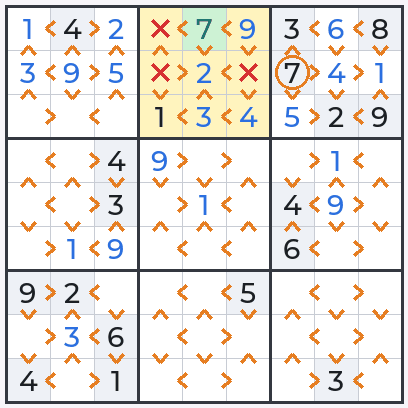

<!-- Written by tools/walkthrough.py greater-than: edit the script, not this page. -->
# Greater-Than, step 21: the 7 in box 2

**Step 21 of 63** · [← Step 20](step-20.md) · [All steps](../greater-than.md#the-whole-puzzle-step-by-step) · [Step 22 →](step-22.md)

Box 2 needs a 7. r2c4 and r2c6: row 2 has one (r2c7). r1c4: the chains of signs in its box keep it between 1 and 6. Only **r1c5** is left: **r1c5 = 7**.

**Step 21 of 63** · [← Step 20](step-20.md) · [All steps](../greater-than.md#the-whole-puzzle-step-by-step) · [Step 22 →](step-22.md)
