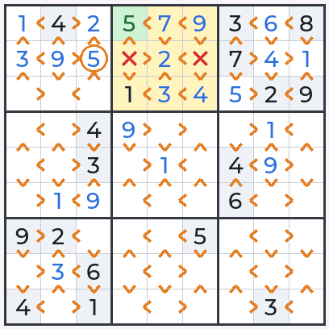

<!-- Written by tools/walkthrough.py greater-than: edit the script, not this page. -->
# Greater-Than, step 22: the 5 in box 2

**Step 22 of 63** · [← Step 21](step-21.md) · [All steps](../greater-than.md#the-whole-puzzle-step-by-step) · [Step 23 →](step-23.md)

Box 2 needs a 5. r2c4 and r2c6: row 2 has one (r2c3). Only **r1c4** is left: **r1c4 = 5**.

**Step 22 of 63** · [← Step 21](step-21.md) · [All steps](../greater-than.md#the-whole-puzzle-step-by-step) · [Step 23 →](step-23.md)
