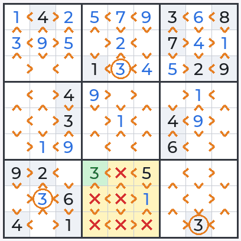

<!-- Written by tools/walkthrough.py greater-than: edit the script, not this page. -->
# Greater-Than, step 24: the 3 in box 8

**Step 24 of 63** · [← Step 23](step-23.md) · [All steps](../greater-than.md#the-whole-puzzle-step-by-step) · [Step 25 →](step-25.md)

Box 8 needs a 3. r7c5: column 5 has one (r3c5). r8c4 and r8c5: row 8 has one (r8c2). r9c4, r9c5 and r9c6: row 9 has one (r9c8). Only **r7c4** is left: **r7c4 = 3**.

**Step 24 of 63** · [← Step 23](step-23.md) · [All steps](../greater-than.md#the-whole-puzzle-step-by-step) · [Step 25 →](step-25.md)
