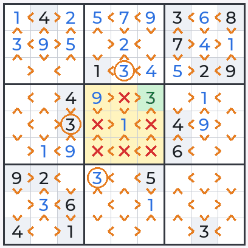

<!-- Written by tools/walkthrough.py greater-than: edit the script, not this page. -->
# Greater-Than, step 25: the 3 in box 5

**Step 25 of 63** · [← Step 24](step-24.md) · [All steps](../greater-than.md#the-whole-puzzle-step-by-step) · [Step 26 →](step-26.md)

Box 5 needs a 3. r4c5 and r6c5: column 5 has one (r3c5). r5c4 and r5c6: row 5 has one (r5c3). r6c4: column 4 has one (r7c4). r6c6: the chains of signs in its box keep it between 7 and 9. Only **r4c6** is left: **r4c6 = 3**.

**Step 25 of 63** · [← Step 24](step-24.md) · [All steps](../greater-than.md#the-whole-puzzle-step-by-step) · [Step 26 →](step-26.md)
