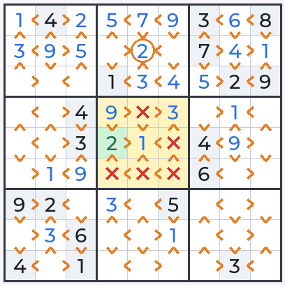

<!-- Written by tools/walkthrough.py greater-than: edit the script, not this page. -->
# Greater-Than, step 26: the 2 in box 5

**Step 26 of 63** · [← Step 25](step-25.md) · [All steps](../greater-than.md#the-whole-puzzle-step-by-step) · [Step 27 →](step-27.md)

Box 5 needs a 2. r4c5 and r6c5: column 5 has one (r2c5). r5c6: the chains of signs in its box keep it between 3 and 8. r6c4: the chains of signs in its box keep it between 3 and 7. r6c6: the chains of signs in its box keep it between 7 and 9. Only **r5c4** is left: **r5c4 = 2**.

**Step 26 of 63** · [← Step 25](step-25.md) · [All steps](../greater-than.md#the-whole-puzzle-step-by-step) · [Step 27 →](step-27.md)
