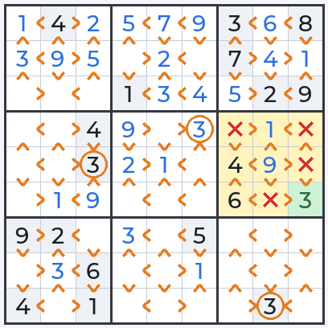

<!-- Written by tools/walkthrough.py greater-than: edit the script, not this page. -->
# Greater-Than, step 27: the 3 in box 6

**Step 27 of 63** · [← Step 26](step-26.md) · [All steps](../greater-than.md#the-whole-puzzle-step-by-step) · [Step 28 →](step-28.md)

Box 6 needs a 3. r4c7 and r4c9: row 4 has one (r4c6). r5c9: row 5 has one (r5c3). r6c8: column 8 has one (r9c8). Only **r6c9** is left: **r6c9 = 3**.

**Step 27 of 63** · [← Step 26](step-26.md) · [All steps](../greater-than.md#the-whole-puzzle-step-by-step) · [Step 28 →](step-28.md)
