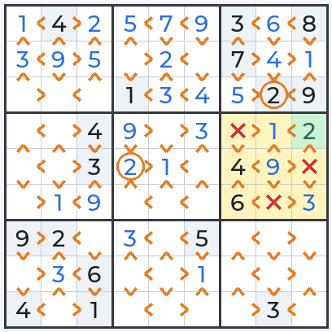

<!-- Written by tools/walkthrough.py greater-than: edit the script, not this page. -->
# Greater-Than, step 28: the 2 in box 6

**Step 28 of 63** · [← Step 27](step-27.md) · [All steps](../greater-than.md#the-whole-puzzle-step-by-step) · [Step 29 →](step-29.md)

Box 6 needs a 2. r5c9: row 5 has one (r5c4). r6c8: column 8 has one (r3c8). r4c7: the chains of signs in its box keep it between 3 and 9. Only **r4c9** is left: **r4c9 = 2**.

**Step 28 of 63** · [← Step 27](step-27.md) · [All steps](../greater-than.md#the-whole-puzzle-step-by-step) · [Step 29 →](step-29.md)
