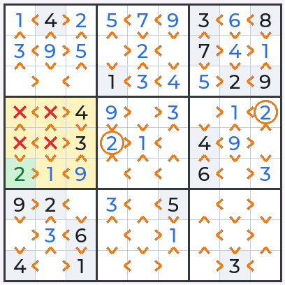

<!-- Written by tools/walkthrough.py greater-than: edit the script, not this page. -->
# Greater-Than, step 29: the 2 in box 4

**Step 29 of 63** · [← Step 28](step-28.md) · [All steps](../greater-than.md#the-whole-puzzle-step-by-step) · [Step 30 →](step-30.md)

Box 4 needs a 2. r4c1 and r4c2: row 4 has one (r4c9). r5c1 and r5c2: row 5 has one (r5c4). Only **r6c1** is left: **r6c1 = 2**.

**Step 29 of 63** · [← Step 28](step-28.md) · [All steps](../greater-than.md#the-whole-puzzle-step-by-step) · [Step 30 →](step-30.md)
