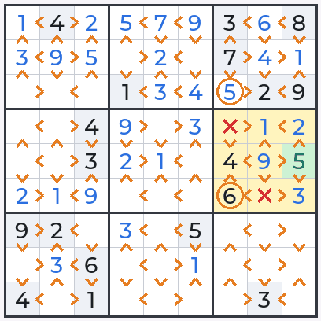

<!-- Written by tools/walkthrough.py greater-than: edit the script, not this page. -->
# Greater-Than, step 30: the 5 in box 6

**Step 30 of 63** · [← Step 29](step-29.md) · [All steps](../greater-than.md#the-whole-puzzle-step-by-step) · [Step 31 →](step-31.md)

Box 6 needs a 5. r4c7: column 7 has one (r3c7). r6c8: the sign says it's bigger than the 6 in r6c7. Only **r5c9** is left: **r5c9 = 5**.

**Step 30 of 63** · [← Step 29](step-29.md) · [All steps](../greater-than.md#the-whole-puzzle-step-by-step) · [Step 31 →](step-31.md)
