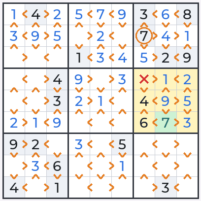

<!-- Written by tools/walkthrough.py greater-than: edit the script, not this page. -->
# Greater-Than, step 31: the 7 in box 6

**Step 31 of 63** · [← Step 30](step-30.md) · [All steps](../greater-than.md#the-whole-puzzle-step-by-step) · [Step 32 →](step-32.md)

Box 6 needs a 7. r4c7: column 7 has one (r2c7). Only **r6c8** is left: **r6c8 = 7**.

**Step 31 of 63** · [← Step 30](step-30.md) · [All steps](../greater-than.md#the-whole-puzzle-step-by-step) · [Step 32 →](step-32.md)
