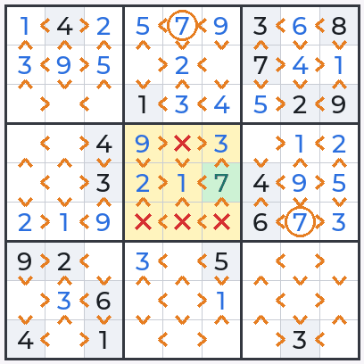

<!-- Written by tools/walkthrough.py greater-than: edit the script, not this page. -->
# Greater-Than, step 32: the 7 in box 5

**Step 32 of 63** · [← Step 31](step-31.md) · [All steps](../greater-than.md#the-whole-puzzle-step-by-step) · [Step 33 →](step-33.md)

Box 5 needs a 7. r4c5: column 5 has one (r1c5). r6c4, r6c5 and r6c6: row 6 has one (r6c8). Only **r5c6** is left: **r5c6 = 7**.

**Step 32 of 63** · [← Step 31](step-31.md) · [All steps](../greater-than.md#the-whole-puzzle-step-by-step) · [Step 33 →](step-33.md)
