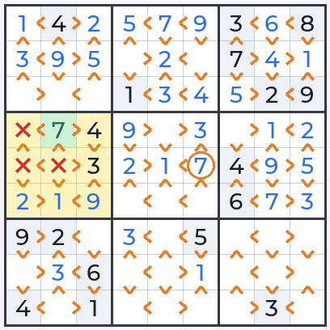

<!-- Written by tools/walkthrough.py greater-than: edit the script, not this page. -->
# Greater-Than, step 33: the 7 in box 4

**Step 33 of 63** · [← Step 32](step-32.md) · [All steps](../greater-than.md#the-whole-puzzle-step-by-step) · [Step 34 →](step-34.md)

Box 4 needs a 7. r5c1 and r5c2: row 5 has one (r5c6). r4c1: the chains of signs in its box keep it between 1 and 6. Only **r4c2** is left: **r4c2 = 7**.

**Step 33 of 63** · [← Step 32](step-32.md) · [All steps](../greater-than.md#the-whole-puzzle-step-by-step) · [Step 34 →](step-34.md)
