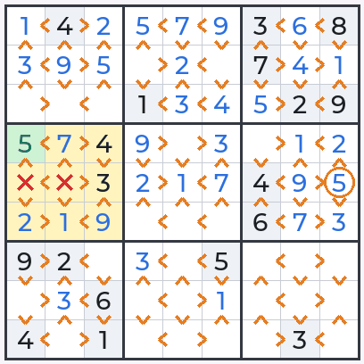

<!-- Written by tools/walkthrough.py greater-than: edit the script, not this page. -->
# Greater-Than, step 34: the 5 in box 4

**Step 34 of 63** · [← Step 33](step-33.md) · [All steps](../greater-than.md#the-whole-puzzle-step-by-step) · [Step 35 →](step-35.md)

Box 4 needs a 5. r5c1 and r5c2: row 5 has one (r5c9). Only **r4c1** is left: **r4c1 = 5**.

**Step 34 of 63** · [← Step 33](step-33.md) · [All steps](../greater-than.md#the-whole-puzzle-step-by-step) · [Step 35 →](step-35.md)
