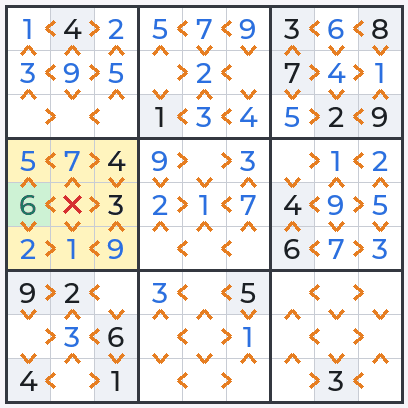

<!-- Written by tools/walkthrough.py greater-than: edit the script, not this page. -->
# Greater-Than, step 35: the 6 in box 4

**Step 35 of 63** · [← Step 34](step-34.md) · [All steps](../greater-than.md#the-whole-puzzle-step-by-step) · [Step 36 →](step-36.md)

Box 4 needs a 6. r5c2: the chains of signs in its box keep it between 8 and 9. Only **r5c1** is left: **r5c1 = 6**.

**Step 35 of 63** · [← Step 34](step-34.md) · [All steps](../greater-than.md#the-whole-puzzle-step-by-step) · [Step 36 →](step-36.md)
