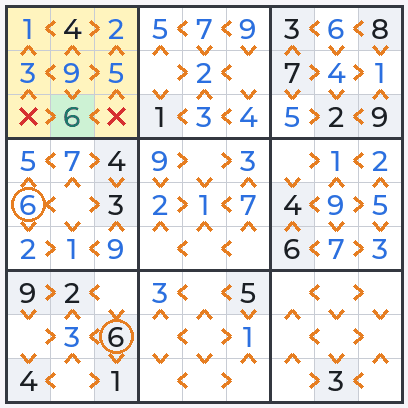

<!-- Written by tools/walkthrough.py greater-than: edit the script, not this page. -->
# Greater-Than, step 36: the 6 in box 1

**Step 36 of 63** · [← Step 35](step-35.md) · [All steps](../greater-than.md#the-whole-puzzle-step-by-step) · [Step 37 →](step-37.md)

Box 1 needs a 6. r3c1: column 1 has one (r5c1). r3c3: column 3 has one (r8c3). Only **r3c2** is left: **r3c2 = 6**.

**Step 36 of 63** · [← Step 35](step-35.md) · [All steps](../greater-than.md#the-whole-puzzle-step-by-step) · [Step 37 →](step-37.md)
