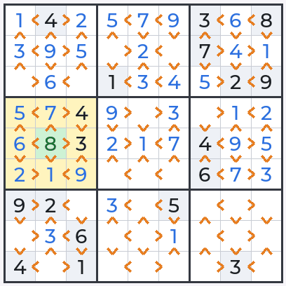

<!-- Written by tools/walkthrough.py greater-than: edit the script, not this page. -->
# Greater-Than, step 37: the 8 in box 4

**Step 37 of 63** · [← Step 36](step-36.md) · [All steps](../greater-than.md#the-whole-puzzle-step-by-step) · [Step 38 →](step-38.md)

Box 4 needs an 8, and r5c2 is its last empty cell: **r5c2 = 8**.

**Step 37 of 63** · [← Step 36](step-36.md) · [All steps](../greater-than.md#the-whole-puzzle-step-by-step) · [Step 38 →](step-38.md)
