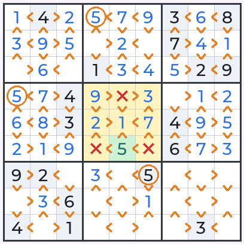

<!-- Written by tools/walkthrough.py greater-than: edit the script, not this page. -->
# Greater-Than, step 38: the 5 in box 5

**Step 38 of 63** · [← Step 37](step-37.md) · [All steps](../greater-than.md#the-whole-puzzle-step-by-step) · [Step 39 →](step-39.md)

Box 5 needs a 5. r4c5: row 4 has one (r4c1). r6c4: column 4 has one (r1c4). r6c6: column 6 has one (r7c6). Only **r6c5** is left: **r6c5 = 5**.

**Step 38 of 63** · [← Step 37](step-37.md) · [All steps](../greater-than.md#the-whole-puzzle-step-by-step) · [Step 39 →](step-39.md)
