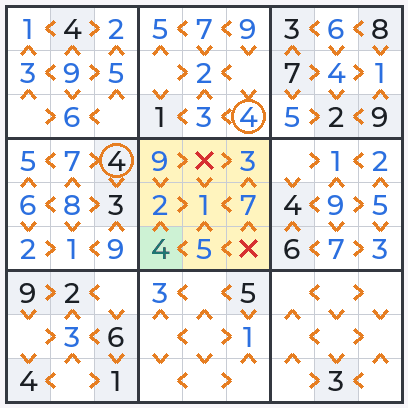

<!-- Written by tools/walkthrough.py greater-than: edit the script, not this page. -->
# Greater-Than, step 39: the 4 in box 5

**Step 39 of 63** · [← Step 38](step-38.md) · [All steps](../greater-than.md#the-whole-puzzle-step-by-step) · [Step 40 →](step-40.md)

Box 5 needs a 4. r4c5: row 4 has one (r4c3). r6c6: column 6 has one (r3c6). Only **r6c4** is left: **r6c4 = 4**.

**Step 39 of 63** · [← Step 38](step-38.md) · [All steps](../greater-than.md#the-whole-puzzle-step-by-step) · [Step 40 →](step-40.md)
