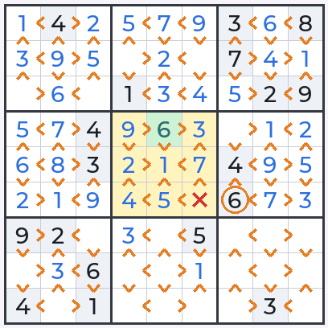

<!-- Written by tools/walkthrough.py greater-than: edit the script, not this page. -->
# Greater-Than, step 40: the 6 in box 5

**Step 40 of 63** · [← Step 39](step-39.md) · [All steps](../greater-than.md#the-whole-puzzle-step-by-step) · [Step 41 →](step-41.md)

Box 5 needs a 6. r6c6: row 6 has one (r6c7). Only **r4c5** is left: **r4c5 = 6**.

**Step 40 of 63** · [← Step 39](step-39.md) · [All steps](../greater-than.md#the-whole-puzzle-step-by-step) · [Step 41 →](step-41.md)
