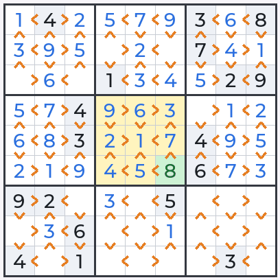

<!-- Written by tools/walkthrough.py greater-than: edit the script, not this page. -->
# Greater-Than, step 41: the 8 in box 5

**Step 41 of 63** · [← Step 40](step-40.md) · [All steps](../greater-than.md#the-whole-puzzle-step-by-step) · [Step 42 →](step-42.md)

Box 5 needs an 8, and r6c6 is its last empty cell: **r6c6 = 8**.

**Step 41 of 63** · [← Step 40](step-40.md) · [All steps](../greater-than.md#the-whole-puzzle-step-by-step) · [Step 42 →](step-42.md)
