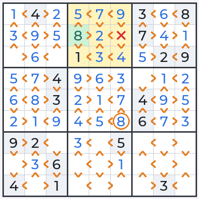

<!-- Written by tools/walkthrough.py greater-than: edit the script, not this page. -->
# Greater-Than, step 42: the 8 in box 2

**Step 42 of 63** · [← Step 41](step-41.md) · [All steps](../greater-than.md#the-whole-puzzle-step-by-step) · [Step 43 →](step-43.md)

Box 2 needs an 8. r2c6: column 6 has one (r6c6). Only **r2c4** is left: **r2c4 = 8**.

**Step 42 of 63** · [← Step 41](step-41.md) · [All steps](../greater-than.md#the-whole-puzzle-step-by-step) · [Step 43 →](step-43.md)
