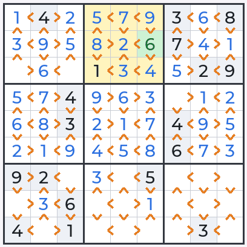

<!-- Written by tools/walkthrough.py greater-than: edit the script, not this page. -->
# Greater-Than, step 43: the 6 in box 2

**Step 43 of 63** · [← Step 42](step-42.md) · [All steps](../greater-than.md#the-whole-puzzle-step-by-step) · [Step 44 →](step-44.md)

Box 2 needs a 6, and r2c6 is its last empty cell: **r2c6 = 6**.

**Step 43 of 63** · [← Step 42](step-42.md) · [All steps](../greater-than.md#the-whole-puzzle-step-by-step) · [Step 44 →](step-44.md)
