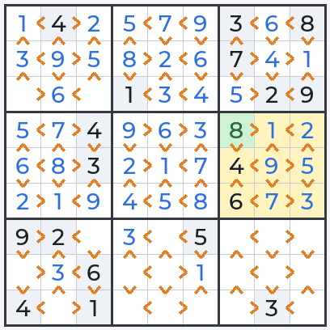

<!-- Written by tools/walkthrough.py greater-than: edit the script, not this page. -->
# Greater-Than, step 44: the 8 in box 6

**Step 44 of 63** · [← Step 43](step-43.md) · [All steps](../greater-than.md#the-whole-puzzle-step-by-step) · [Step 45 →](step-45.md)

Box 6 needs an 8, and r4c7 is its last empty cell: **r4c7 = 8**.

**Step 44 of 63** · [← Step 43](step-43.md) · [All steps](../greater-than.md#the-whole-puzzle-step-by-step) · [Step 45 →](step-45.md)
