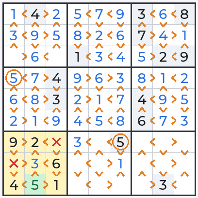

<!-- Written by tools/walkthrough.py greater-than: edit the script, not this page. -->
# Greater-Than, step 45: the 5 in box 7

**Step 45 of 63** · [← Step 44](step-44.md) · [All steps](../greater-than.md#the-whole-puzzle-step-by-step) · [Step 46 →](step-46.md)

Box 7 needs a 5. r7c3: row 7 has one (r7c6). r8c1: column 1 has one (r4c1). Only **r9c2** is left: **r9c2 = 5**.

**Step 45 of 63** · [← Step 44](step-44.md) · [All steps](../greater-than.md#the-whole-puzzle-step-by-step) · [Step 46 →](step-46.md)
