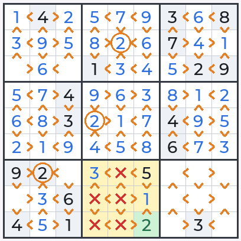

<!-- Written by tools/walkthrough.py greater-than: edit the script, not this page. -->
# Greater-Than, step 46: the 2 in box 8

**Step 46 of 63** · [← Step 45](step-45.md) · [All steps](../greater-than.md#the-whole-puzzle-step-by-step) · [Step 47 →](step-47.md)

Box 8 needs a 2. r7c5: row 7 has one (r7c2). r8c4 and r9c4: column 4 has one (r5c4). r8c5 and r9c5: column 5 has one (r2c5). Only **r9c6** is left: **r9c6 = 2**.

**Step 46 of 63** · [← Step 45](step-45.md) · [All steps](../greater-than.md#the-whole-puzzle-step-by-step) · [Step 47 →](step-47.md)
