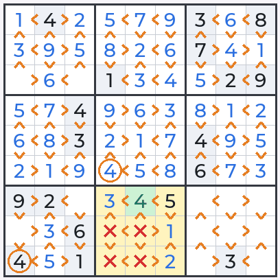

<!-- Written by tools/walkthrough.py greater-than: edit the script, not this page. -->
# Greater-Than, step 47: the 4 in box 8

**Step 47 of 63** · [← Step 46](step-46.md) · [All steps](../greater-than.md#the-whole-puzzle-step-by-step) · [Step 48 →](step-48.md)

Box 8 needs a 4. r8c4: column 4 has one (r6c4). r9c4 and r9c5: row 9 has one (r9c1). r8c5: the chains of signs in its box keep it between 8 and 9. Only **r7c5** is left: **r7c5 = 4**.

**Step 47 of 63** · [← Step 46](step-46.md) · [All steps](../greater-than.md#the-whole-puzzle-step-by-step) · [Step 48 →](step-48.md)
