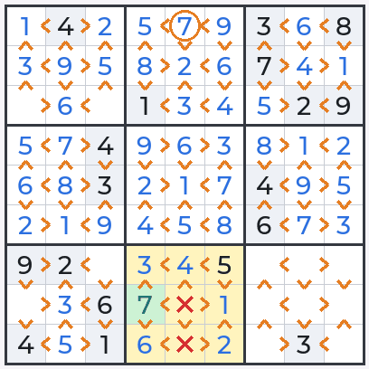

<!-- Written by tools/walkthrough.py greater-than: edit the script, not this page. -->
# Greater-Than, step 49: the 7 in box 8

**Step 49 of 63** · [← Step 48](step-48.md) · [All steps](../greater-than.md#the-whole-puzzle-step-by-step) · [Step 50 →](step-50.md)

Box 8 needs a 7. r8c5 and r9c5: column 5 has one (r1c5). Only **r8c4** is left: **r8c4 = 7**.

**Step 49 of 63** · [← Step 48](step-48.md) · [All steps](../greater-than.md#the-whole-puzzle-step-by-step) · [Step 50 →](step-50.md)
