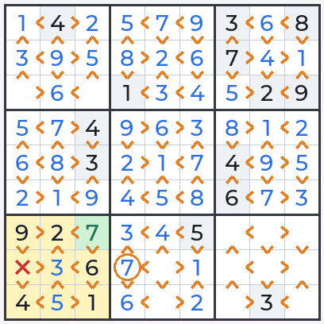

<!-- Written by tools/walkthrough.py greater-than: edit the script, not this page. -->
# Greater-Than, step 50: the 7 in box 7

**Step 50 of 63** · [← Step 49](step-49.md) · [All steps](../greater-than.md#the-whole-puzzle-step-by-step) · [Step 51 →](step-51.md)

Box 7 needs a 7. r8c1: row 8 has one (r8c4). Only **r7c3** is left: **r7c3 = 7**.

**Step 50 of 63** · [← Step 49](step-49.md) · [All steps](../greater-than.md#the-whole-puzzle-step-by-step) · [Step 51 →](step-51.md)
