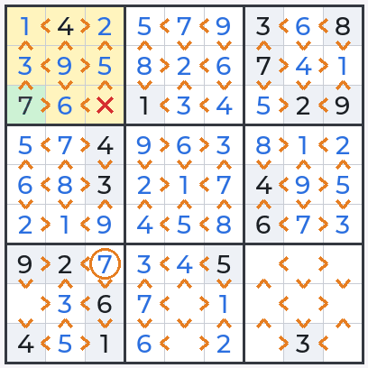

<!-- Written by tools/walkthrough.py greater-than: edit the script, not this page. -->
# Greater-Than, step 51: the 7 in box 1

**Step 51 of 63** · [← Step 50](step-50.md) · [All steps](../greater-than.md#the-whole-puzzle-step-by-step) · [Step 52 →](step-52.md)

Box 1 needs a 7. r3c3: column 3 has one (r7c3). Only **r3c1** is left: **r3c1 = 7**.

**Step 51 of 63** · [← Step 50](step-50.md) · [All steps](../greater-than.md#the-whole-puzzle-step-by-step) · [Step 52 →](step-52.md)
