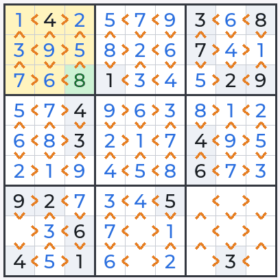

<!-- Written by tools/walkthrough.py greater-than: edit the script, not this page. -->
# Greater-Than, step 52: the 8 in box 1

**Step 52 of 63** · [← Step 51](step-51.md) · [All steps](../greater-than.md#the-whole-puzzle-step-by-step) · [Step 53 →](step-53.md)

Box 1 needs an 8, and r3c3 is its last empty cell: **r3c3 = 8**.

**Step 52 of 63** · [← Step 51](step-51.md) · [All steps](../greater-than.md#the-whole-puzzle-step-by-step) · [Step 53 →](step-53.md)
