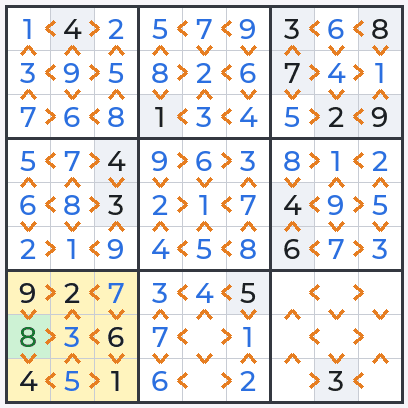

<!-- Written by tools/walkthrough.py greater-than: edit the script, not this page. -->
# Greater-Than, step 53: the 8 in box 7

**Step 53 of 63** · [← Step 52](step-52.md) · [All steps](../greater-than.md#the-whole-puzzle-step-by-step) · [Step 54 →](step-54.md)

Box 7 needs an 8, and r8c1 is its last empty cell: **r8c1 = 8**.

**Step 53 of 63** · [← Step 52](step-52.md) · [All steps](../greater-than.md#the-whole-puzzle-step-by-step) · [Step 54 →](step-54.md)
