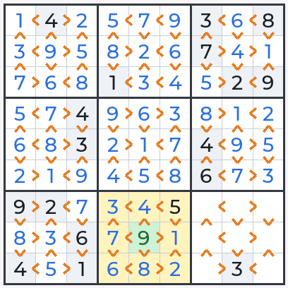

<!-- Written by tools/walkthrough.py greater-than: edit the script, not this page. -->
# Greater-Than, step 55: the 9 in box 8

**Step 55 of 63** · [← Step 54](step-54.md) · [All steps](../greater-than.md#the-whole-puzzle-step-by-step) · [Step 56 →](step-56.md)

Box 8 needs a 9, and r8c5 is its last empty cell: **r8c5 = 9**.

**Step 55 of 63** · [← Step 54](step-54.md) · [All steps](../greater-than.md#the-whole-puzzle-step-by-step) · [Step 56 →](step-56.md)
