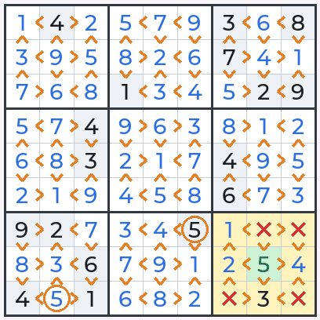

<!-- Written by tools/walkthrough.py greater-than: edit the script, not this page. -->
# Greater-Than, step 59: the 5 in box 9

**Step 59 of 63** · [← Step 58](step-58.md) · [All steps](../greater-than.md#the-whole-puzzle-step-by-step) · [Step 60 →](step-60.md)

Box 9 needs a 5. r7c8 and r7c9: row 7 has one (r7c6). r9c7 and r9c9: row 9 has one (r9c2). Only **r8c8** is left: **r8c8 = 5**.

**Step 59 of 63** · [← Step 58](step-58.md) · [All steps](../greater-than.md#the-whole-puzzle-step-by-step) · [Step 60 →](step-60.md)
