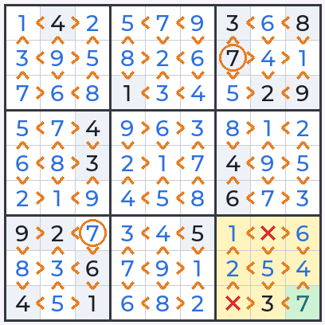

<!-- Written by tools/walkthrough.py greater-than: edit the script, not this page. -->
# Greater-Than, step 61: the 7 in box 9

**Step 61 of 63** · [← Step 60](step-60.md) · [All steps](../greater-than.md#the-whole-puzzle-step-by-step) · [Step 62 →](step-62.md)

Box 9 needs a 7. r7c8: row 7 has one (r7c3). r9c7: column 7 has one (r2c7). Only **r9c9** is left: **r9c9 = 7**.

**Step 61 of 63** · [← Step 60](step-60.md) · [All steps](../greater-than.md#the-whole-puzzle-step-by-step) · [Step 62 →](step-62.md)
