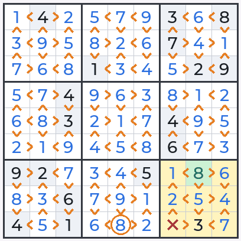

<!-- Written by tools/walkthrough.py greater-than: edit the script, not this page. -->
# Greater-Than, step 62: the 8 in box 9

**Step 62 of 63** · [← Step 61](step-61.md) · [All steps](../greater-than.md#the-whole-puzzle-step-by-step) · [Step 63 →](step-63.md)

Box 9 needs an 8. r9c7: row 9 has one (r9c5). Only **r7c8** is left: **r7c8 = 8**.

**Step 62 of 63** · [← Step 61](step-61.md) · [All steps](../greater-than.md#the-whole-puzzle-step-by-step) · [Step 63 →](step-63.md)
