# Hyper

[← All variants](README.md) · [Puzzles](../features-puzzles.md) · [How to play](../how-to-play.md)

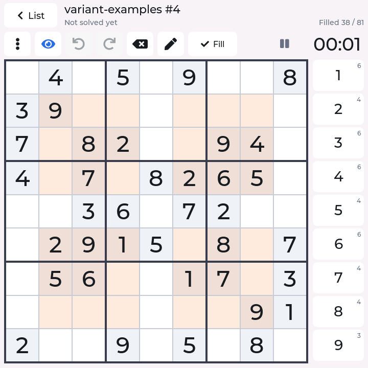

## The rules

[Classic](classic.md) rules, and four extra 3×3 **windows** must also hold 1 to 9, each once. The windows sit one cell in from the edges, between the boxes: rows 2–4 and 6–8 crossed with columns 2–4 and 6–8. Also known as Windoku.

## On the board

- The 36 window cells are tinted, like the X-Sudoku diagonals.
- A repeat in a window turns red; hints name the windows ("Look at the top-left window").
- **Puzzles → ⋮ → New puzzle → Hyper**; it's also Thursday's daily puzzle (Hard).

## How to solve it

- Each window is a tenth to thirteenth "box": a hidden single can be in a window.
- A window overlaps four boxes, so the cells *outside* a window in those boxes are tied to it: if a box's digit must be inside the window, it can't be anywhere else in the window, and the other way round. That gives hidden singles in the thin strips between windows.
- A cell inside a window has 26 neighbours instead of 20, so window cells run out of candidates first: look there for naked singles.

## Worked example

**variant-examples #4**, Hyper Easy (see [Classic](classic.md#worked-example-the-whole-puzzle) for how to import the examples; cells are written r*row*c*column*).

The top-left window is rows 2–4, columns 2–4; the top-right one is rows 2–4, columns 6–8.

**Step 1: r2c4, in the top-left window.** Row 2 has 3 and 9; column 4 has 5, 2, 6 and 1; box 2 has 5, 9 and 2. By the Classic rules r2c4 could still be 4, 7 or 8. But it's in the top-left window, which has a 7 (r4c3) and an 8 (r3c3). **r2c4 = 4**.

**Step 2: r2c7, in the top-right window.** Row 2 now has 3, 9 and 4; column 7 has 9, 6, 2, 8 and 7; box 3 has 8, 9 and 4. That leaves 1 or 5, and the top-right window has a 5 (r4c8). **r2c7 = 1**.

**Step 3: r2c8, in the top-right window too.** Row 2 has 3, 9, 4 and 1; column 8 has 4, 5, 9 and 8; so 2, 6 or 7 are left. The window has a 2 (r4c6) and a 6 (r4c7). **r2c8 = 7**.

Three cells in a row, each settled by a window: that's typical of Hyper, where the windows do as much work as the boxes.

## The whole puzzle, step by step

<!-- walkthrough -->
<!-- Written by tools/walkthrough.py hyper: edit the script, not this part. -->

The whole puzzle, from the start to the last cell: 43 steps, each one a single (one place left for a digit, or one digit left for a cell), taken in the order a box's single comes first, so not quite the order of the worked example above. In each picture, the unit the step looks at is tinted yellow (for a cell with one digit left: its row, column and box), the new digit is on green, the digits that rule cells out have an **orange ring**, and the empty cells they rule out a **red cross**. Givens are on grey, digits from earlier steps in blue.

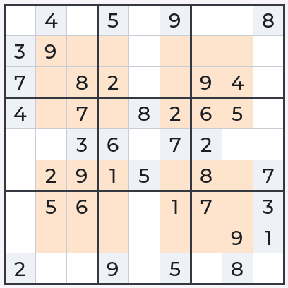

#### Step 1: the 2 in box 1

Box 1 needs a 2. r1c1: column 1 has one (r9c1). r2c3: the top-left window has one (r3c4). r3c2: row 3 has one (r3c4). Only **r1c3** is left: **r1c3 = 2**.

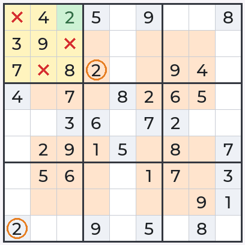

#### Step 2: the 5 in box 1

Box 1 needs a 5. r1c1: row 1 has one (r1c4). r3c2: column 2 has one (r7c2). Only **r2c3** is left: **r2c3 = 5**.

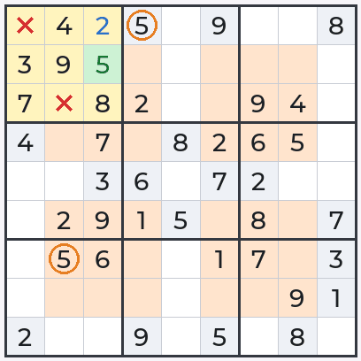

#### Step 3: the 8 in box 2

Box 2 needs an 8. r1c5: row 1 has one (r1c9). r2c4: the top-left window has one (r3c3). r2c5: column 5 has one (r4c5). r3c5 and r3c6: row 3 has one (r3c3). Only **r2c6** is left: **r2c6 = 8**.

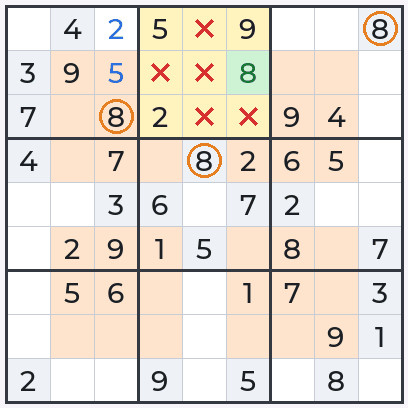

#### Step 4: the 2 in box 3

Box 3 needs a 2. r1c7 and r1c8: row 1 has one (r1c3). r2c7: column 7 has one (r5c7). r2c8: the top-right window has one (r4c6). r3c9: row 3 has one (r3c4). Only **r2c9** is left: **r2c9 = 2**.

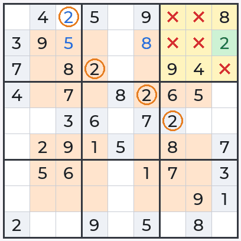

#### Step 5: the 5 in box 3

Box 3 needs a 5. r1c7 and r1c8: row 1 has one (r1c4). r2c7 and r2c8: row 2 has one (r2c3). Only **r3c9** is left: **r3c9 = 5**.

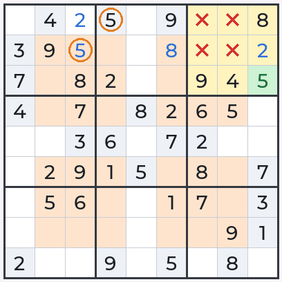

#### Step 6: the 6 in box 3

Box 3 needs a 6. r1c7 and r2c7: column 7 has one (r4c7). r2c8: the top-right window has one (r4c7). Only **r1c8** is left: **r1c8 = 6**.

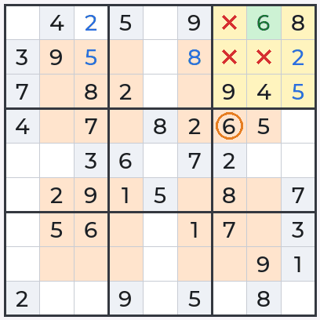

#### Step 7: the 6 in box 1

Box 1 needs a 6. r1c1: row 1 has one (r1c8). Only **r3c2** is left: **r3c2 = 6**.

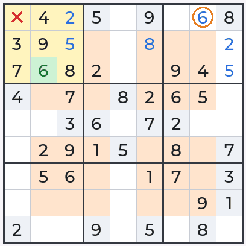

#### Step 8: the 1 in box 1

Box 1 needs a 1, and r1c1 is its last empty cell: **r1c1 = 1**.

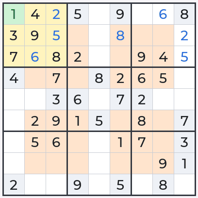

#### Step 9: the 6 in box 2

Box 2 needs a 6. r1c5: row 1 has one (r1c8). r2c4: column 4 has one (r5c4). r3c5 and r3c6: row 3 has one (r3c2). Only **r2c5** is left: **r2c5 = 6**.

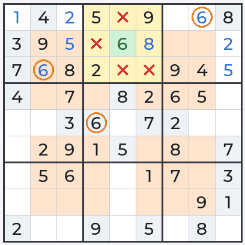

#### Step 10: the 1 in box 2

Box 2 needs a 1. r1c5: row 1 has one (r1c1). r2c4: column 4 has one (r6c4). r3c6: column 6 has one (r7c6). Only **r3c5** is left: **r3c5 = 1**.

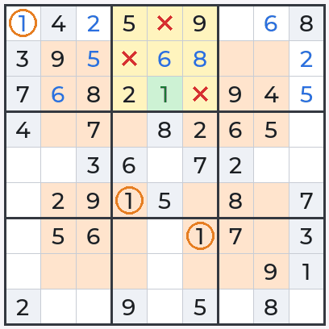

#### Step 11: the 4 in box 2

Box 2 needs a 4. r1c5: row 1 has one (r1c2). r3c6: row 3 has one (r3c8). Only **r2c4** is left: **r2c4 = 4**.

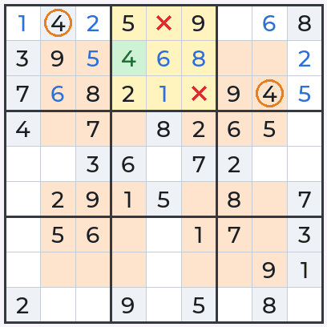

#### Step 12: the 7 in box 2

Box 2 needs a 7. r3c6: row 3 has one (r3c1). Only **r1c5** is left: **r1c5 = 7**.

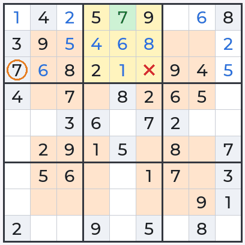

#### Step 13: the 3 in box 2

Box 2 needs a 3, and r3c6 is its last empty cell: **r3c6 = 3**.

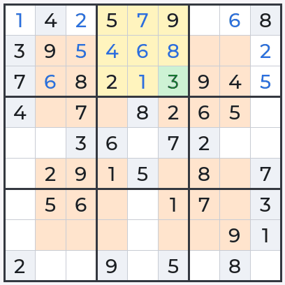

#### Step 14: the 3 in box 3

Box 3 needs a 3. r2c7 and r2c8: row 2 has one (r2c1). Only **r1c7** is left: **r1c7 = 3**.

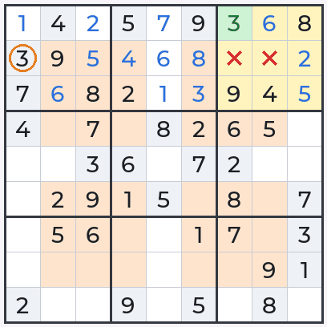

#### Step 15: the 7 in box 3

Box 3 needs a 7. r2c7: column 7 has one (r7c7). Only **r2c8** is left: **r2c8 = 7**.

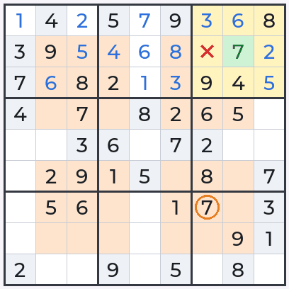

#### Step 16: the 1 in box 3

Box 3 needs a 1, and r2c7 is its last empty cell: **r2c7 = 1**.

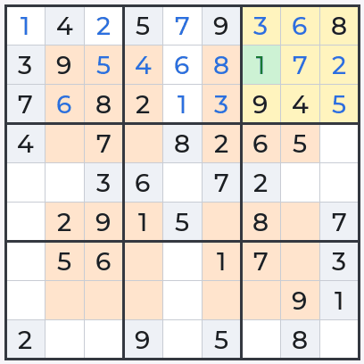

#### Step 17: the 5 in box 4

Box 4 needs a 5. r4c2: row 4 has one (r4c8). r5c2: column 2 has one (r7c2). r6c1: row 6 has one (r6c5). Only **r5c1** is left: **r5c1 = 5**.

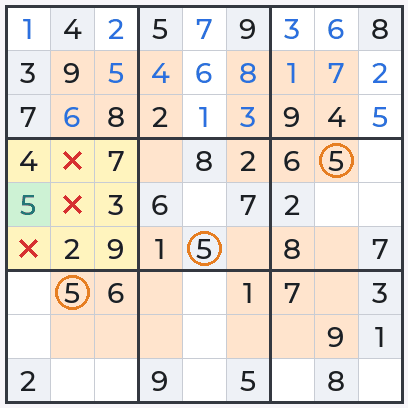

#### Step 18: the 6 in box 4

Box 4 needs a 6. r4c2: row 4 has one (r4c7). r5c2: row 5 has one (r5c4). Only **r6c1** is left: **r6c1 = 6**.

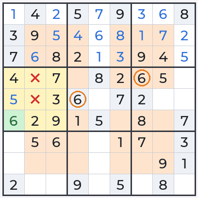

#### Step 19: the 8 in box 4

Box 4 needs an 8. r4c2: row 4 has one (r4c5). Only **r5c2** is left: **r5c2 = 8**.

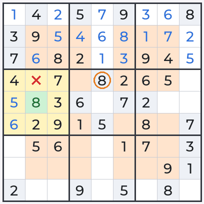

#### Step 20: the 1 in box 4

Box 4 needs a 1, and r4c2 is its last empty cell: **r4c2 = 1**.

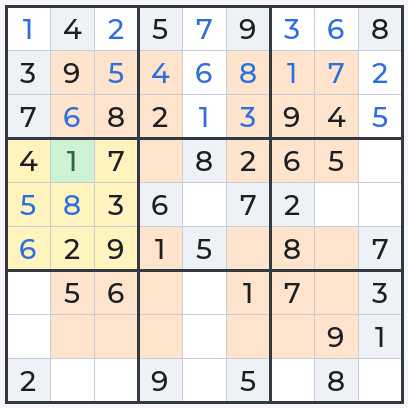

#### Step 21: the 3 in box 5

Box 5 needs a 3. r5c5: row 5 has one (r5c3). r6c6: column 6 has one (r3c6). Only **r4c4** is left: **r4c4 = 3**.

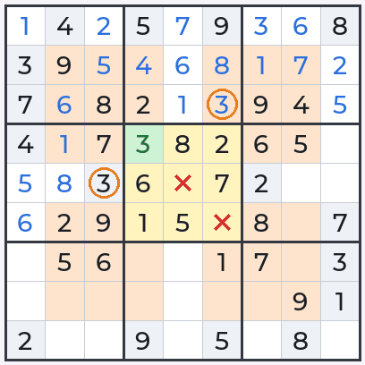

#### Step 22: the 9 in box 5

Box 5 needs a 9. r6c6: row 6 has one (r6c3). Only **r5c5** is left: **r5c5 = 9**.

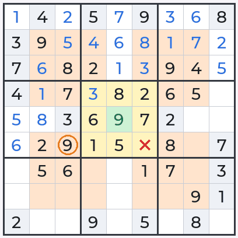

#### Step 23: the 4 in box 5

Box 5 needs a 4, and r6c6 is its last empty cell: **r6c6 = 4**.

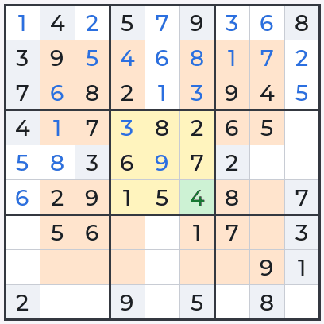

#### Step 24: the 1 in box 6

Box 6 needs a 1. r4c9: row 4 has one (r4c2). r5c9: column 9 has one (r8c9). r6c8: row 6 has one (r6c4). Only **r5c8** is left: **r5c8 = 1**.

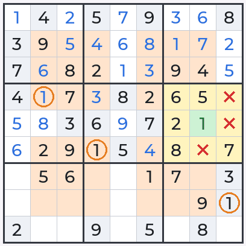

#### Step 25: the 3 in box 6

Box 6 needs a 3. r4c9: row 4 has one (r4c4). r5c9: row 5 has one (r5c3). Only **r6c8** is left: **r6c8 = 3**.

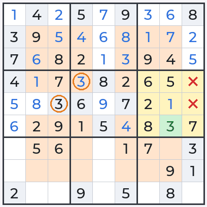

#### Step 26: the 4 in box 6

Box 6 needs a 4. r4c9: row 4 has one (r4c1). Only **r5c9** is left: **r5c9 = 4**.

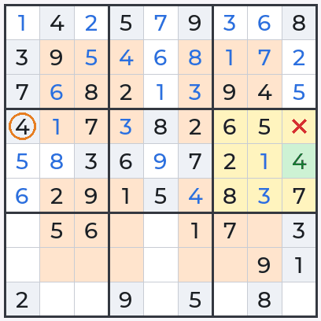

#### Step 27: the 9 in box 6

Box 6 needs a 9, and r4c9 is its last empty cell: **r4c9 = 9**.

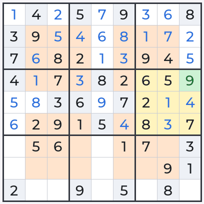

#### Step 28: the 1 in box 7

Box 7 needs a 1. r7c1: row 7 has one (r7c6). r8c1, r8c2 and r8c3: row 8 has one (r8c9). r9c2: column 2 has one (r4c2). Only **r9c3** is left: **r9c3 = 1**.

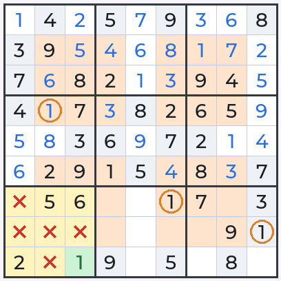

#### Step 29: the 4 in box 7

Box 7 needs a 4. r7c1 and r8c1: column 1 has one (r4c1). r8c2 and r9c2: column 2 has one (r1c2). Only **r8c3** is left: **r8c3 = 4**.

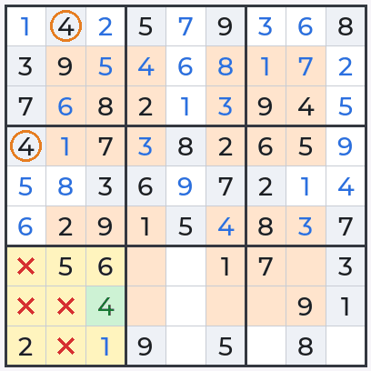

#### Step 30: the 9 in box 7

Box 7 needs a 9. r8c1 and r8c2: row 8 has one (r8c8). r9c2: row 9 has one (r9c4). Only **r7c1** is left: **r7c1 = 9**.

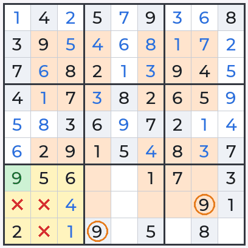

#### Step 31: the 8 in box 7

Box 7 needs an 8. r8c2: column 2 has one (r5c2). r9c2: row 9 has one (r9c8). Only **r8c1** is left: **r8c1 = 8**.

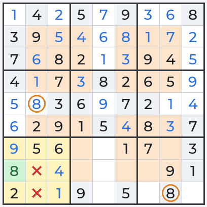

#### Step 32: the 6 in box 8

Box 8 needs a 6. r7c4 and r7c5: row 7 has one (r7c3). r8c4: column 4 has one (r5c4). r8c5 and r9c5: column 5 has one (r2c5). Only **r8c6** is left: **r8c6 = 6**.

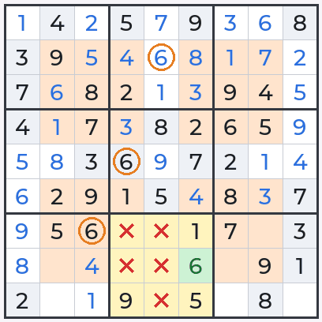

#### Step 33: the 7 in box 8

Box 8 needs a 7. r7c4 and r7c5: row 7 has one (r7c7). r8c5 and r9c5: column 5 has one (r1c5). Only **r8c4** is left: **r8c4 = 7**.

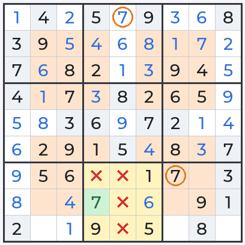

#### Step 34: the 7 in box 7

Box 7 needs a 7. r8c2: row 8 has one (r8c4). Only **r9c2** is left: **r9c2 = 7**.

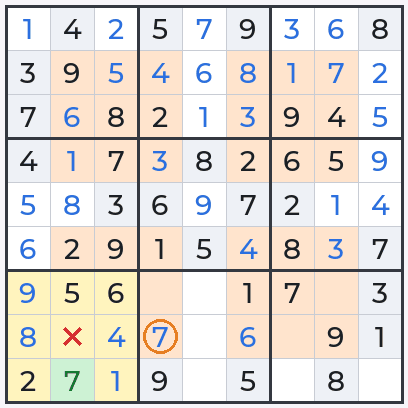

#### Step 35: the 3 in box 7

Box 7 needs a 3, and r8c2 is its last empty cell: **r8c2 = 3**.

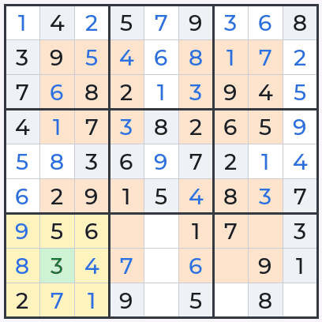

#### Step 36: the 3 in box 8

Box 8 needs a 3. r7c4 and r7c5: row 7 has one (r7c9). r8c5: row 8 has one (r8c2). Only **r9c5** is left: **r9c5 = 3**.

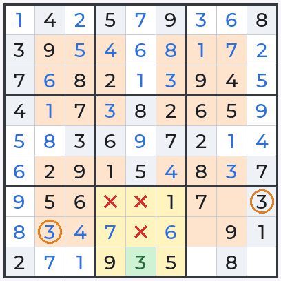

#### Step 37: the 4 in box 8

Box 8 needs a 4. r7c4: column 4 has one (r2c4). r8c5: row 8 has one (r8c3). Only **r7c5** is left: **r7c5 = 4**.

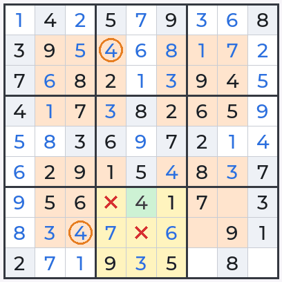

#### Step 38: the 2 in box 8

Box 8 needs a 2. r7c4: column 4 has one (r3c4). Only **r8c5** is left: **r8c5 = 2**.

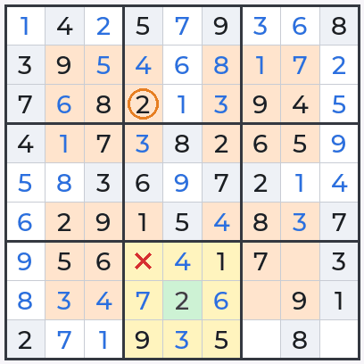

#### Step 39: the 8 in box 8

Box 8 needs an 8, and r7c4 is its last empty cell: **r7c4 = 8**.

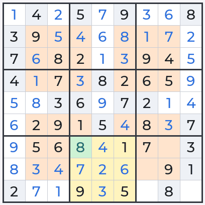

#### Step 40: the 2 in box 9

Box 9 needs a 2. r8c7: row 8 has one (r8c5). r9c7 and r9c9: row 9 has one (r9c1). Only **r7c8** is left: **r7c8 = 2**.

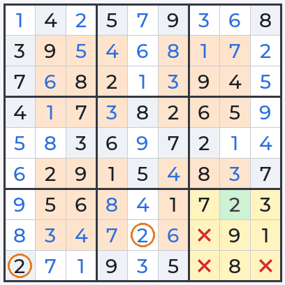

#### Step 41: the 4 in box 9

Box 9 needs a 4. r8c7: row 8 has one (r8c3). r9c9: column 9 has one (r5c9). Only **r9c7** is left: **r9c7 = 4**.

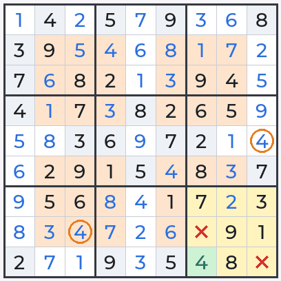

#### Step 42: the 5 in box 9

Box 9 needs a 5. r9c9: row 9 has one (r9c6). Only **r8c7** is left: **r8c7 = 5**.

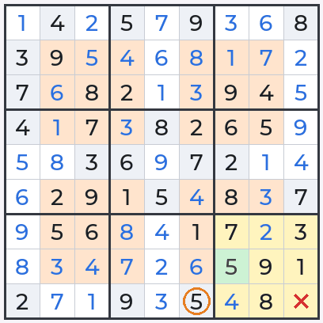

#### Step 43: the 6 in box 9

Box 9 needs a 6, and r9c9 is its last empty cell: **r9c9 = 6**.

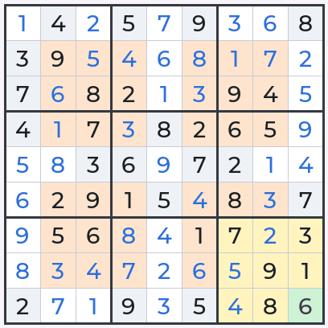

Solved.

<!-- /walkthrough -->
