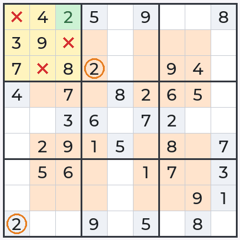

<!-- Written by tools/walkthrough.py hyper: edit the script, not this page. -->
# Hyper, step 1: the 2 in box 1

**Step 1 of 43** · [← The start](../hyper.md#the-whole-puzzle-step-by-step) · [All steps](../hyper.md#the-whole-puzzle-step-by-step) · [Step 2 →](step-02.md)

Box 1 needs a 2. r1c1: column 1 has one (r9c1). r2c3: the top-left window has one (r3c4). r3c2: row 3 has one (r3c4). Only **r1c3** is left: **r1c3 = 2**.

**Step 1 of 43** · [← The start](../hyper.md#the-whole-puzzle-step-by-step) · [All steps](../hyper.md#the-whole-puzzle-step-by-step) · [Step 2 →](step-02.md)
