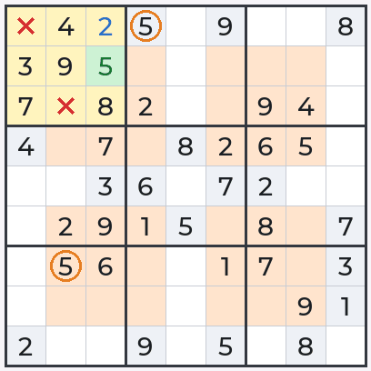

<!-- Written by tools/walkthrough.py hyper: edit the script, not this page. -->
# Hyper, step 2: the 5 in box 1

**Step 2 of 43** · [← Step 1](step-01.md) · [All steps](../hyper.md#the-whole-puzzle-step-by-step) · [Step 3 →](step-03.md)

Box 1 needs a 5. r1c1: row 1 has one (r1c4). r3c2: column 2 has one (r7c2). Only **r2c3** is left: **r2c3 = 5**.

**Step 2 of 43** · [← Step 1](step-01.md) · [All steps](../hyper.md#the-whole-puzzle-step-by-step) · [Step 3 →](step-03.md)
