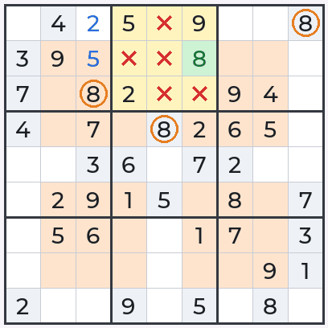

<!-- Written by tools/walkthrough.py hyper: edit the script, not this page. -->
# Hyper, step 3: the 8 in box 2

**Step 3 of 43** · [← Step 2](step-02.md) · [All steps](../hyper.md#the-whole-puzzle-step-by-step) · [Step 4 →](step-04.md)

Box 2 needs an 8. r1c5: row 1 has one (r1c9). r2c4: the top-left window has one (r3c3). r2c5: column 5 has one (r4c5). r3c5 and r3c6: row 3 has one (r3c3). Only **r2c6** is left: **r2c6 = 8**.

**Step 3 of 43** · [← Step 2](step-02.md) · [All steps](../hyper.md#the-whole-puzzle-step-by-step) · [Step 4 →](step-04.md)
