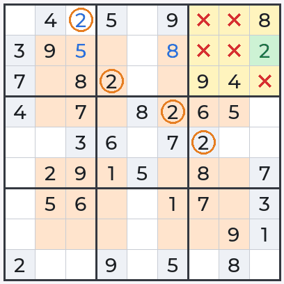

<!-- Written by tools/walkthrough.py hyper: edit the script, not this page. -->
# Hyper, step 4: the 2 in box 3

**Step 4 of 43** · [← Step 3](step-03.md) · [All steps](../hyper.md#the-whole-puzzle-step-by-step) · [Step 5 →](step-05.md)

Box 3 needs a 2. r1c7 and r1c8: row 1 has one (r1c3). r2c7: column 7 has one (r5c7). r2c8: the top-right window has one (r4c6). r3c9: row 3 has one (r3c4). Only **r2c9** is left: **r2c9 = 2**.

**Step 4 of 43** · [← Step 3](step-03.md) · [All steps](../hyper.md#the-whole-puzzle-step-by-step) · [Step 5 →](step-05.md)
