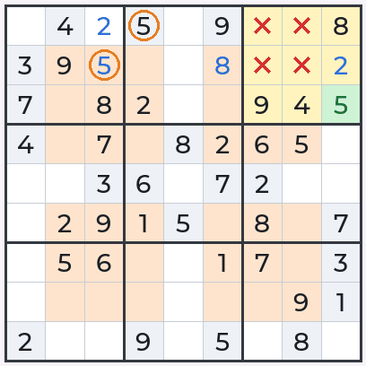

<!-- Written by tools/walkthrough.py hyper: edit the script, not this page. -->
# Hyper, step 5: the 5 in box 3

**Step 5 of 43** · [← Step 4](step-04.md) · [All steps](../hyper.md#the-whole-puzzle-step-by-step) · [Step 6 →](step-06.md)

Box 3 needs a 5. r1c7 and r1c8: row 1 has one (r1c4). r2c7 and r2c8: row 2 has one (r2c3). Only **r3c9** is left: **r3c9 = 5**.

**Step 5 of 43** · [← Step 4](step-04.md) · [All steps](../hyper.md#the-whole-puzzle-step-by-step) · [Step 6 →](step-06.md)
