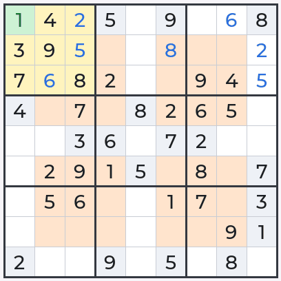

<!-- Written by tools/walkthrough.py hyper: edit the script, not this page. -->
# Hyper, step 8: the 1 in box 1

**Step 8 of 43** · [← Step 7](step-07.md) · [All steps](../hyper.md#the-whole-puzzle-step-by-step) · [Step 9 →](step-09.md)

Box 1 needs a 1, and r1c1 is its last empty cell: **r1c1 = 1**.

**Step 8 of 43** · [← Step 7](step-07.md) · [All steps](../hyper.md#the-whole-puzzle-step-by-step) · [Step 9 →](step-09.md)
