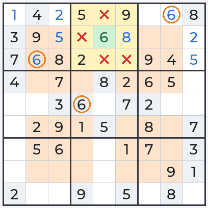

<!-- Written by tools/walkthrough.py hyper: edit the script, not this page. -->
# Hyper, step 9: the 6 in box 2

**Step 9 of 43** · [← Step 8](step-08.md) · [All steps](../hyper.md#the-whole-puzzle-step-by-step) · [Step 10 →](step-10.md)

Box 2 needs a 6. r1c5: row 1 has one (r1c8). r2c4: column 4 has one (r5c4). r3c5 and r3c6: row 3 has one (r3c2). Only **r2c5** is left: **r2c5 = 6**.

**Step 9 of 43** · [← Step 8](step-08.md) · [All steps](../hyper.md#the-whole-puzzle-step-by-step) · [Step 10 →](step-10.md)
