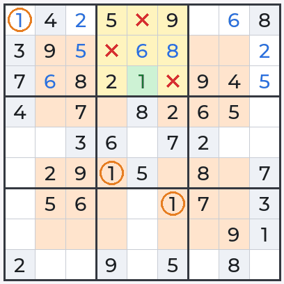

<!-- Written by tools/walkthrough.py hyper: edit the script, not this page. -->
# Hyper, step 10: the 1 in box 2

**Step 10 of 43** · [← Step 9](step-09.md) · [All steps](../hyper.md#the-whole-puzzle-step-by-step) · [Step 11 →](step-11.md)

Box 2 needs a 1. r1c5: row 1 has one (r1c1). r2c4: column 4 has one (r6c4). r3c6: column 6 has one (r7c6). Only **r3c5** is left: **r3c5 = 1**.

**Step 10 of 43** · [← Step 9](step-09.md) · [All steps](../hyper.md#the-whole-puzzle-step-by-step) · [Step 11 →](step-11.md)
