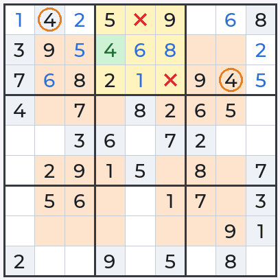

<!-- Written by tools/walkthrough.py hyper: edit the script, not this page. -->
# Hyper, step 11: the 4 in box 2

**Step 11 of 43** · [← Step 10](step-10.md) · [All steps](../hyper.md#the-whole-puzzle-step-by-step) · [Step 12 →](step-12.md)

Box 2 needs a 4. r1c5: row 1 has one (r1c2). r3c6: row 3 has one (r3c8). Only **r2c4** is left: **r2c4 = 4**.

**Step 11 of 43** · [← Step 10](step-10.md) · [All steps](../hyper.md#the-whole-puzzle-step-by-step) · [Step 12 →](step-12.md)
