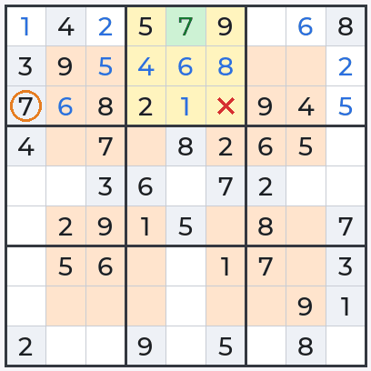

<!-- Written by tools/walkthrough.py hyper: edit the script, not this page. -->
# Hyper, step 12: the 7 in box 2

**Step 12 of 43** · [← Step 11](step-11.md) · [All steps](../hyper.md#the-whole-puzzle-step-by-step) · [Step 13 →](step-13.md)

Box 2 needs a 7. r3c6: row 3 has one (r3c1). Only **r1c5** is left: **r1c5 = 7**.

**Step 12 of 43** · [← Step 11](step-11.md) · [All steps](../hyper.md#the-whole-puzzle-step-by-step) · [Step 13 →](step-13.md)
