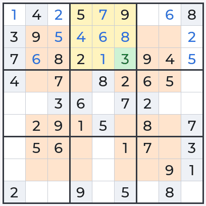

<!-- Written by tools/walkthrough.py hyper: edit the script, not this page. -->
# Hyper, step 13: the 3 in box 2

**Step 13 of 43** · [← Step 12](step-12.md) · [All steps](../hyper.md#the-whole-puzzle-step-by-step) · [Step 14 →](step-14.md)

Box 2 needs a 3, and r3c6 is its last empty cell: **r3c6 = 3**.

**Step 13 of 43** · [← Step 12](step-12.md) · [All steps](../hyper.md#the-whole-puzzle-step-by-step) · [Step 14 →](step-14.md)
