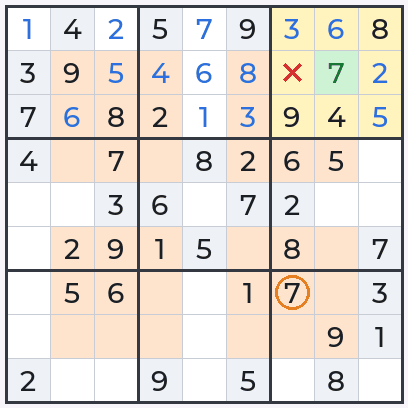

<!-- Written by tools/walkthrough.py hyper: edit the script, not this page. -->
# Hyper, step 15: the 7 in box 3

**Step 15 of 43** · [← Step 14](step-14.md) · [All steps](../hyper.md#the-whole-puzzle-step-by-step) · [Step 16 →](step-16.md)

Box 3 needs a 7. r2c7: column 7 has one (r7c7). Only **r2c8** is left: **r2c8 = 7**.

**Step 15 of 43** · [← Step 14](step-14.md) · [All steps](../hyper.md#the-whole-puzzle-step-by-step) · [Step 16 →](step-16.md)
