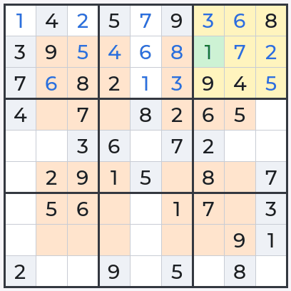

<!-- Written by tools/walkthrough.py hyper: edit the script, not this page. -->
# Hyper, step 16: the 1 in box 3

**Step 16 of 43** · [← Step 15](step-15.md) · [All steps](../hyper.md#the-whole-puzzle-step-by-step) · [Step 17 →](step-17.md)

Box 3 needs a 1, and r2c7 is its last empty cell: **r2c7 = 1**.

**Step 16 of 43** · [← Step 15](step-15.md) · [All steps](../hyper.md#the-whole-puzzle-step-by-step) · [Step 17 →](step-17.md)
