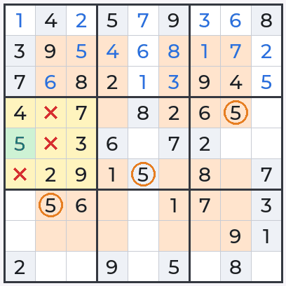

<!-- Written by tools/walkthrough.py hyper: edit the script, not this page. -->
# Hyper, step 17: the 5 in box 4

**Step 17 of 43** · [← Step 16](step-16.md) · [All steps](../hyper.md#the-whole-puzzle-step-by-step) · [Step 18 →](step-18.md)

Box 4 needs a 5. r4c2: row 4 has one (r4c8). r5c2: column 2 has one (r7c2). r6c1: row 6 has one (r6c5). Only **r5c1** is left: **r5c1 = 5**.

**Step 17 of 43** · [← Step 16](step-16.md) · [All steps](../hyper.md#the-whole-puzzle-step-by-step) · [Step 18 →](step-18.md)
